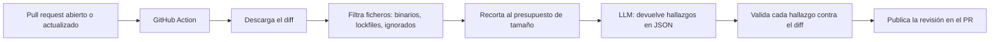

# AI PR Reviewer


GitHub Action que revisa cada pull request con un modelo de lenguaje y deja **comentarios en las líneas concretas** donde ve errores, riesgos de seguridad o lógica sin tests, más un resumen del PR.

Se puede usar de dos formas:
- **Modelo local, sin claves ni coste:** con `provider: ollama`, la Action arranca un modelo abierto (`qwen2.5-coder:7b`) dentro del propio runner de GitHub. El código no sale de GitHub.
- **Cualquier API compatible con OpenAI:** **Azure OpenAI**, OpenAI, Google Gemini… o [llm-gateway](https://github.com/adrirodrigar1999/llm-gateway) delante de ellos, para controlar el coste y los modelos permitidos por equipo.

👉 [Ver un ejemplo real de revisión](https://github.com/adrirodrigar1999/ai-pr-reviewer/pulls?q=is%3Apr+Demo)

## Cómo funciona



1. **Prepara el diff.** Lo parsea, descarta ficheros borrados, binarios, lockfiles y rutas ignoradas, y numera cada línea añadida con su número en el fichero nuevo.
2. **Pregunta al modelo** con un prompt que pide solo problemas reales (bug, security, tests, performance, maintainability) y una respuesta en JSON estructurado.
3. **Valida la respuesta.** Los LLM a veces se inventan ficheros o se equivocan de línea. El modelo debe citar el fragmento de código de cada hallazgo, y el revisor **ancla el comentario a la línea añadida que de verdad contiene ese código** (por coincidencia exacta o aproximada). Lo que no se puede ubicar en el diff se descarta y se cuenta, y los hallazgos repetidos se agrupan.
4. **Publica una revisión** con un resumen y comentarios en línea. Si GitHub rechaza algún comentario en línea, publica al menos el resumen.

## Uso

### Opción A: modelo local con Ollama (sin claves)

```yaml
name: Revisión con IA
on:
  pull_request:
    types: [opened, synchronize, reopened]

permissions:
  contents: read
  pull-requests: write

jobs:
  review:
    runs-on: ubuntu-latest
    timeout-minutes: 20
    steps:
      - uses: actions/checkout@v4
      - uses: adrirodrigar1999/ai-pr-reviewer@v1
        with:
          provider: ollama
```

La primera ejecución descarga el modelo (~4,7 GB) y lo guarda en la caché de Actions. Cada revisión tarda unos 3 minutos en un runner estándar, sin GPU.

### Opción B: API de un proveedor (Azure OpenAI, llm-gateway…)

1. Crea los secretos `LLM_BASE_URL` y `LLM_API_KEY` en *Settings → Secrets and variables → Actions*.
2. Copia [`examples/ai-review.yml`](examples/ai-review.yml) en `.github/workflows/` de tu repositorio:

```yaml
name: Revisión con IA
on:
  pull_request:
    types: [opened, synchronize, reopened]

permissions:
  contents: read
  pull-requests: write

jobs:
  review:
    runs-on: ubuntu-latest
    steps:
      - uses: actions/checkout@v4
      - uses: adrirodrigar1999/ai-pr-reviewer@v1
        with:
          llm-base-url: ${{ secrets.LLM_BASE_URL }}
          llm-api-key: ${{ secrets.LLM_API_KEY }}
          llm-auth: api-key        # Azure OpenAI; "bearer" para el resto
          model: gpt-4o-mini
```

Si faltan los secretos, la Action no rompe el PR: muestra un aviso y omite la revisión.

### Proveedores

| Proveedor | `llm-base-url` | `llm-auth` |
|---|---|---|
| Azure OpenAI (API v1) | `https://<recurso>.openai.azure.com/openai/v1` | `api-key` |
| llm-gateway | `https://<tu-gateway>/v1` | `bearer` |
| OpenAI | `https://api.openai.com/v1` | `bearer` |
| Google Gemini | `https://generativelanguage.googleapis.com/v1beta/openai` | `bearer` |
| Ollama (local) | `http://localhost:11434/v1` | `bearer` |

### Entradas

| Entrada | Por defecto | Descripción |
|---|---|---|
| `provider` | *(vacío)* | `ollama` para usar un modelo local en el runner |
| `ollama-model` | `qwen2.5-coder:7b` | Modelo de Ollama |
| `llm-base-url` | — | API compatible con OpenAI (si no se usa `provider`) |
| `llm-api-key` | — | Clave del proveedor, como secreto (si no se usa `provider`) |
| `llm-auth` | `bearer` | `bearer` o `api-key` (Azure OpenAI) |
| `model` | `gpt-4o-mini` | Modelo o deployment |
| `fail-on` | `none` | `low` / `medium` / `high`: marca el check como fallido si hay hallazgos de esa prioridad o mayor |
| `max-diff-chars` | `60000` | Tamaño máximo del diff enviado (controla coste y contexto) |
| `config-path` | `.ai-review.yml` | Configuración del repositorio |
| `github-token` | `github.token` | Token para leer el PR y comentar |

### Configuración por repositorio (`.ai-review.yml`)

```yaml
language: español          # idioma de los comentarios
min_severity: medium       # no publicar hallazgos de prioridad baja
max_comments: 10           # tope de comentarios por PR
rules:                     # normas propias del equipo que el modelo tendrá en cuenta
  - Toda consulta SQL debe usar parámetros.
  - Los endpoints nuevos necesitan test de integración.
ignore:
  - "migrations/*"
  - "docs/*"
```

### Ejecutarlo en local

```bash
pip install -e ".[dev]"
git diff main > cambios.diff
LLM_BASE_URL=http://localhost:8080/v1 LLM_API_KEY=<clave> LLM_MODEL=mock-model \
  python -m reviewer --diff-file cambios.diff
```

Imprime la revisión en Markdown sin publicar nada. Con el `llm-gateway` levantado en local puedes probarlo sin coste usando `mock-model` u Ollama.

## Modelo local frente a API

| | Ollama en el runner (`qwen2.5-coder:7b`) | API (p. ej. Azure OpenAI `gpt-4o-mini`) |
|---|---|---|
| Coste | 0 € (minutos de Actions) | Por tokens |
| Claves / cuentas | Ninguna | Recurso y secreto |
| Privacidad | El código no sale de GitHub | Se envía al proveedor |
| Tiempo por revisión | ~3 min | Segundos |
| Calidad | Detecta los problemas claros | Mejor con lógica sutil |

En las pruebas, el modelo de 3B fallaba los números de línea y mezclaba los mensajes. Con 7B y el anclaje por contenido, los cuatro errores del PR de demostración (inyección SQL, secreto en el código, división por cero y petición sin timeout) se señalan en su línea correcta.

## Decisiones de diseño

- **Anclaje por contenido:** los modelos, sobre todo los pequeños, fallan el número de línea con frecuencia. Pedir además la cita del código y buscarla en el diff hace que los comentarios caigan en su sitio.
- **Validar antes de publicar:** un comentario en la línea equivocada resta más confianza que no comentar. Por eso los hallazgos que no apuntan a una línea añadida se descartan.
- **Solo líneas añadidas:** la revisión se centra en lo que el PR introduce, no en el código que ya existía.
- **Prompt conservador:** se pide no comentar estilo ni gustos, y devolver una lista vacía si no hay problemas, para reducir el ruido.
- **Presupuesto de tamaño:** si el diff es muy grande, se priorizan los ficheros pequeños completos en lugar de cortar ficheros por la mitad, y el resumen indica qué quedó sin revisar.
- **Independiente del proveedor:** cualquier API con `/chat/completions` sirve. Si el modelo no admite el modo JSON, se reintenta sin él y se extrae el JSON de la respuesta.
- **Orientativo:** se publica como `COMMENT`, nunca aprueba ni bloquea por sí mismo salvo que se configure `fail-on`.

## Desarrollo

```bash
pip install -e ".[dev]"
ruff check . && pytest -v
```

Los tests no hacen llamadas reales: usan dobles de prueba para la API de GitHub y del modelo, e incluyen un caso de extremo a extremo que simula el evento de un PR. Este repositorio se revisa a sí mismo con [`.github/workflows/ai-review.yml`](.github/workflows/ai-review.yml).

## Hoja de ruta

- [ ] Probar modelos locales con GPU (runners de GitHub con GPU o autoalojados)
- [ ] Actualizar la revisión anterior en lugar de crear una nueva en cada push
- [ ] Revisar solo los commits nuevos desde la última revisión
- [ ] Sugerencias aplicables con un clic (bloques `suggestion` de GitHub)
- [ ] Métricas de calidad: porcentaje de comentarios útiles marcados por los revisores

## Licencia

MIT
